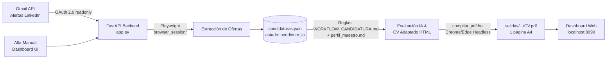

# 📡 Radar de Candidaturas

> Sistema local de ingesta, evaluación asistida por IA y gestión de candidaturas técnicas con integración de **Gmail API**, scraping mediante **Playwright**, dashboard en **FastAPI** y compilación automática de CVs en **PDF (A4)**.


---

## 🧠 Visión General

**Radar de Candidaturas** centraliza el ciclo completo de búsqueda de empleo técnico en un entorno local controlado:

1. **Ingesta automática y manual:** Escanea alertas recientes de LinkedIn en Gmail (`from:linkedin.com newer_than:5d`) o permite registrar ofertas manualmente desde el dashboard.
2. **Extracción de detalles:** Normaliza las URLs de LinkedIn extraídas de los correos y utiliza **Playwright** (lanzando **Google Chrome** en modo visible con un perfil persistente propio en `browser_session/`, o Chromium como respaldo) para extraer puesto, empresa, modalidad y descripción de cada vacante. Si LinkedIn muestra un *authwall*, puedes iniciar sesión manualmente en esa ventana y la sesión quedará guardada en `browser_session/`.
3. **Evaluación y adaptación con IA:** Aplica las reglas operativas de [`WORKFLOW_CANDIDATURA.md`](./WORKFLOW_CANDIDATURA.md) contrastadas con [`perfil_maestro.md`](./perfil_maestro.md) para clasificar viabilidad, calcular horquillas salariales, redactar cartas de presentación/respuestas ATS y adaptar el CV.
4. **Compilación PDF a 1 página A4:** Renderiza plantillas HTML (`plantilla_cv.html` → `cv_adaptado.html`) a PDF mediante Chromium/Edge en modo *headless* (`compilar_pdf.bat`).
5. **Panel de control local:** Dashboard web servido en `http://127.0.0.1:8090` para revisar candidaturas, copiar textos en 1 clic, abrir CVs y actualizar estados.

---

## 🏗️ Arquitectura y Flujo de Trabajo



### Ciclo de estados de una candidatura

| Estado | Descripción |
| :--- | :--- |
| `pendiente_ia` | Oferta recién capturada (vía Gmail o manual) pendiente de análisis. |
| `lista_para_aplicar` | Oferta viable con horquilla salarial, carta, respuesta ATS y CV PDF generados. |
| `aplicada` | Candidatura enviada por el usuario. |
| `descartada` | Oferta filtrada automáticamente o por el usuario con `motivo_descarte`. |

---

## 🛠️ Stack Tecnológico

- **Backend & API:** Python, FastAPI, Uvicorn, Pydantic
- **Integración Google:** `google-api-python-client`, `google-auth`, `google-auth-oauthlib` (scope `gmail.readonly`)
- **Automatización Web:** Playwright lanzando Google Chrome real (`channel="chrome"`, con respaldo en Chromium) y perfil persistente en `browser_session/`
- **Frontend:** HTML/CSS/JS autocontenido (`dashboard.html`)
- **Generación de Documentos:** HTML/CSS A4 (`plantilla_cv.html`) + compilación vía `compilar_pdf.bat` (Google Chrome / Microsoft Edge `--headless --print-to-pdf`)
- **Persistencia:** Almacenamiento local en JSON con escritura atómica (`candidaturas.json`)

---

## 📁 Estructura del Repositorio

```text
radar-candidaturas/
├── app.py                      # Servidor FastAPI, integración Gmail API y scraping Playwright
├── dashboard.html              # Interfaz web del panel de candidaturas
├── plantilla_cv.html           # Plantilla base HTML/CSS (1 página A4) para los CVs
├── compilar_pdf.bat            # Script Windows para compilar HTML -> PDF vía Chrome/Edge headless
├── WORKFLOW_CANDIDATURA.md     # Reglas operativas de evaluación, filtrado y generación para IA
├── perfil_maestro.md           # Perfil técnico base y criterios de referencia
├── candidaturas.example.json   # Plantilla de estructura para candidaturas.json
├── requirements.txt            # Dependencias de Python
└── .gitignore                  # Excluye credenciales, tokens, datos locales y salidas
```

> **Nota de privacidad:** Archivos sensibles y datos locales (`credentials.json`, `token.json`, `candidaturas.json`, `browser_session/`, `salidas/`, `.env`, `.venv/`) están excluidos del control de versiones mediante `.gitignore`.

---

## 🚀 Instalación y Puesta en Marcha

### 1. Clonar el repositorio y crear el entorno virtual

```bash
git clone https://github.com/jimmypazosg/radar-candidaturas-linkedin.git
cd radar-candidaturas-linkedin

python -m venv .venv
# Windows (PowerShell)
.\.venv\Scripts\Activate.ps1
```

### 2. Instalar dependencias y navegadores de Playwright

```bash
pip install -r requirements.txt
playwright install chromium
```

### 3. Configurar credenciales y archivos locales

1. Crea un proyecto en **Google Cloud Console**, habilita la **Gmail API** y descarga las credenciales OAuth 2.0 (tipo *Desktop App*) como `credentials.json` en la raíz del proyecto.
2. Inicializa tu base de datos local si lo deseas (la aplicación también crea `candidaturas.json` automáticamente si no existe):
   ```bash
   copy candidaturas.example.json candidaturas.json
   ```
3. Asegúrate de tener **Google Chrome** o **Microsoft Edge** instalado en Windows para que `compilar_pdf.bat` pueda generar los PDFs.

### 4. Ejecutar el servidor

```bash
python app.py
```

Abre el dashboard en tu navegador:
**`http://127.0.0.1:8090`**

---

## 🔌 Endpoints de la API

| Método | Ruta | Descripción |
| :--- | :--- | :--- |
| `GET` | `/` | Sirve el dashboard web (`dashboard.html`). |
| `GET` | `/api/estado` | Devuelve el estado de autenticación de Gmail y el conteo por estados. |
| `POST` | `/api/reauth` | Inicia o renueva el flujo OAuth 2.0 de Google y guarda `token.json`. |
| `POST` | `/api/escanear-gmail` | Busca alertas recientes de LinkedIn en Gmail y extrae detalles con Playwright. |
| `POST` | `/api/oferta-manual` | Registra una nueva oferta manualmente en estado `pendiente_ia`. |
| `POST` | `/api/actualizar/{item_id}` | Actualiza `estado`, `notas` o `motivo_descarte` de una candidatura. |
| `GET` | `/api/cv/{item_id}` | Sirve el archivo `CV_Jimmy_Pazos.pdf` asociado a la candidatura. |

---

## 📄 Compilación manual de CV a PDF

Puedes probar o compilar cualquier plantilla HTML a PDF A4 desde la raíz del proyecto:

```bat
compilar_pdf.bat "plantilla_cv.html" "CV_Jimmy_Pazos.pdf"
```

---

## 📝 Licencia

Uso personal / privado. Adapta [`perfil_maestro.md`](./perfil_maestro.md) y [`plantilla_cv.html`](./plantilla_cv.html) con tu propia información antes de utilizar el flujo en tu entorno.
